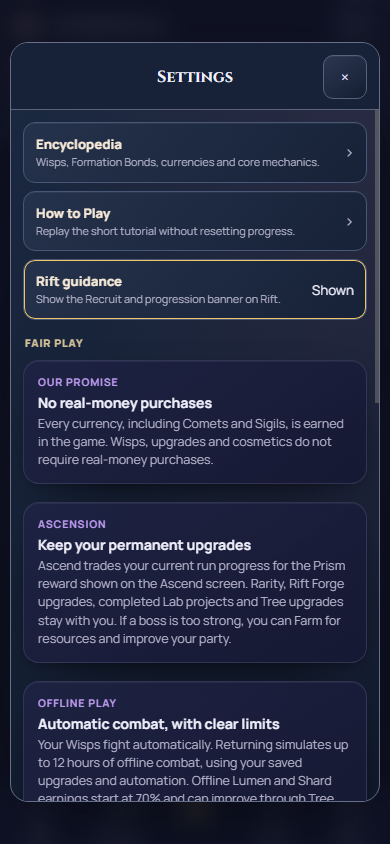

# Fair Play copy verification

14 October 2026. Local implementation milestone; final acceptance OPEN.
Baseline `dea1d16`, branch `local/full-debug`. Node24.19.0,
Chrome151.0.7922.34. Candidate product SHA-256:
`b6b860e7bbc32ac35646d97db84008335dc4a7f2036516792ee6dca3003863b6`.

The seven Settings Fair Play cards now describe actual mechanics in plain
English. Removed unrelated comparisons and guarantees of uninterrupted progress,
universally beneficial resets and complete autoclicker prevention. Offline text
states the12-hour productive cap and70% starting Lumen/Shard rate; Ascend text
describes its tradeoff and permanent upgrades. Luminous encounter chance is
distinguished from the depth/bonus-dependent fixed Mote payout. Wisp abilities
are automatic, Guardian Tap is player damage, and Auto-Tap is a Deed unlock.
No game rule or binding policy was introduced.

- [Copy audit](copy-audit.json): exactly seven records; removing MANIFESTO from
  baseline and candidate produces identical source bytes. Gameplay, CSS, markup,
  rendering/navigation handlers and save code are unchanged.
- Source syntax/IDs/lifecycle guards, actual task context and whitespace PASS.
- [Existing mobile layout](checks.json):6985 assertions/12 profiles PASS, including
  native Settings touch/Enter, Escape/Close and exact opener focus return.
  Widths320/390/430px,100/200% root text and normal/reduced motion.
- [Existing Settings/save-backup](save-backup.txt):12 profiles PASS, including
  navigation, restore confirmation, reload, persistence and focus handling.
- [Existing navigation](navigation.txt): nav-workshop-contract PASS using the
  repository's Windows CDP pipe transport. No test assertion/deadline changed.
- [Preview](preview.json): root/staged/HTTP HTML exactly match. The stopped local
  server was restarted at http://127.0.0.1:4174/index.html; hidden Node PID24524.

Commands: `node scripts/ci/validate_source.cjs`,
`node scripts/codex/check_context.cjs --task docs/tasks/FAIR_PLAY_COPY_001.md`,
`node tests/behavioral/shared-layout-ui.cjs index.html validation-evidence/fair-play-copy-001/layout`,
and existing `run.cjs --web-root mobile/www` scenarios `save-backup-ui` and
`nav-workshop-contract` (separate invocations). Raw evidence remains under
`validation-evidence/fair-play-copy-001/`; durable source-bound summaries,
log extracts and representative screenshots are saved here.

## Visual review and limits

The390px normal and320px/200% Settings screenshots were visually reviewed:
text wraps within the cards, modal Close remains accessible, and long content
uses the existing scroll area. Enlarged text is browser root-font emulation.

[320px enlarged-text screenshot](settings-320-large-text.png).

Initial sandbox Chromium launch closed before loading; the unchanged checks
passed outside the sandbox. Direct in-app browser inspection failed first on
connection refusal and then on its generated error-page URL policy. App preview
opening returned queued; a loaded visible user tab is not claimed.

Self-review only. GitHub/main integration, full required combined CI and
Android/device/WebView60/native textZoom/TalkBack acceptance remain pending.
No push, APK, signing, release or archive action. Inherited debugging failures
remain in the full-debug task. This wording edit changes whole-source identity;
final offline oracle source stamps must be regenerated/verified on the eventual
combined candidate without altering historical gameplay reference values.
