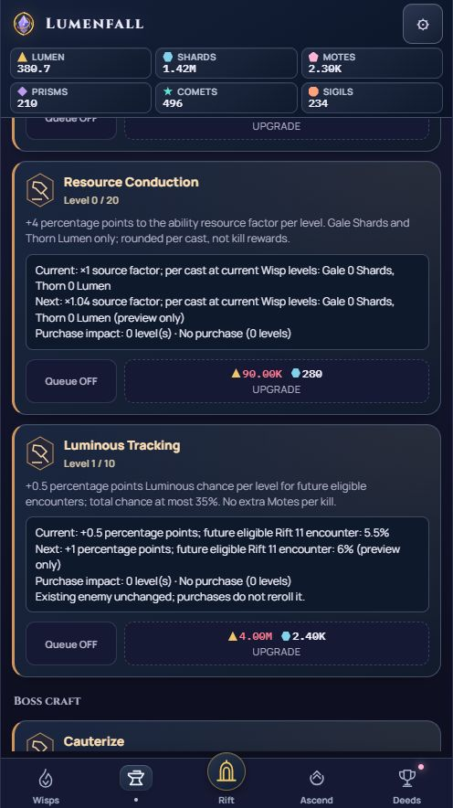

# Option A — cap20 implementation evidence

14 October 2026. User selected **A: All four to 20 (Recommended)** in the explicit
decision prompt after the saved proposal `fe42861`. Branch `local/full-debug`.
Source SHA-256 `509b2dcb98f45207d4b9125cbf39f194adcb58e05690381d306352c733b0b050`.
Node24.19.0 / Chrome151.0.7922.34. Owner self-review only.

Six product lines: arcanecal/conduction/bossledger/luminousdistill caps10→20,
Boss Survey description50%→100%, Luminous Distillation100%→200%. No other product
property, function, CSS, ID, asset, schema, balance or paid-value rule changes.
Upward caps retain raw saves and their effective level under the new ceiling;
no old purchase/work is removed or repriced, and no new refund is required.
Original unlocks, per-level effects, growth curves, speed choices/discounts and
12-hour productive offline cap remain. Other Forge/Lab entries, including Swift
Recovery, its refunds and five uncapped foundations remain unchanged.

## Source-bound checks

All current receipts below use this exact509b2dcb source; proposal/baseline
receipts remain bound to the originalf8f787fd bytes and are not regenerated.

| Check | Result and receipt |
|---|---|
| Focused agreed caps | [2179 assertions/3 causal controls PASS](focused.json): all catalog properties match baseline except agreed edits; every valid old/new Forge quote checked, including original quote preservation and independent exact new totals; manual/bulk/max/queued boundaries; finite exact debits; old schema1/2/3/raw levels and refund records; fixed paid work; cold reload/recovery/backup; live/offline/actual catch-up and first-funded Lab kill boundary; actual conditional kills with other drops/chance unchanged |
| Existing Forge core | [9315 assertions/25 controls PASS](forge-current.json) |
| Existing Lab core | [2675 assertions/10 controls PASS](lab-current.json); original cases retained, adds19/20/21 reward endpoints |
| Existing Lab reward/purchase boundary | [2344 assertions/5 controls PASS](lab-boundary-current.json) |
| Existing charge/combat calibration | [3134 checks/7 controls PASS](forge-calibration-current.json) |
| Existing Forge browser contracts | [6105 checks/588 purchase cases PASS](forge-contracts.json); existing four causal controls reject |
| Existing Forge browser effects | [1952 checks PASS](forge-effects.json); real casts, rounding, exclusion and new cap endpoints |
| Existing chronology/balance | [chronology13](forge-chronology.json), [balance36](forge-balance.json), [early/mid/mature baseline](forge-baseline-browser.json) PASS with actual purchases/simulation |
| Existing actual persistence | [reload](forge-save-reload.json), [backup restore](forge-backup-restore.json), [corrupt-primary recovery](forge-recovery.json) PASS |
| Focused cap20 mobile | [552 checks/12 profiles PASS](mobile/receipt.json): all four full-price/cap/effect rows fit320/390/430px at100/200% text in both motion modes; real touch/Enter pays displayed quotes, pending Lab snapshots then authoritative completion, disabled final cap, primary/recovery saves and real reload; no runtime errors, clean browser exit |
| Existing full Lab mobile | [6588 checks/12 profiles PASS](lab-mobile-existing/receipt.json): all20 cards/14 additions, actual starts/completions, affordability, speed/queue/accessibility, seven paid records/reload and fit |
| Existing Rift/navigation | [1738 Rift/415 nav PASS](rift-navigation/results.json), no runtime exceptions, clean teardown |
| Source/context/diff | Syntax of2 scripts,16 unique required IDs/lifecycle, actual task links/startup budget and whitespace PASS |

Commands from repository root; set LUMENFALL_QA_CDP_CHROME to the installed
`../work/browsers/chromium-1234/chrome-win64/chrome.exe` absolute path. Browser
execution/host loopback need outside-sandbox access in this Windows environment.

```text
node tests/behavioral/forge-lab-caps.cjs index.html --negative
node tests/behavioral/forge-expansion.cjs index.html --negative
node tests/behavioral/lab-expansion.cjs index.html --negative
node tests/behavioral/lab-expansion-boundary.cjs index.html --negative
node tests/behavioral/forge-expansion-calibration.cjs index.html --negative
node tests/behavioral/forge-lab-caps-mobile.cjs mobile/www/index.html docs/qa/forge-lab-caps-001/mobile
node tests/behavioral/lab-expansion-ui.cjs mobile/www/index.html docs/qa/forge-lab-caps-001/lab-mobile-existing
node docs/qa/lab-affordable-alert-001/run-existing.cjs index.html SCENARIO
node tests/behavioral/rift-guidance.cjs CHROME mobile/www docs/qa/forge-lab-caps-001/rift-navigation --existing-contract
node scripts/codex/check_context.cjs --task docs/tasks/FORGE_LAB_CAPS_001.md
node scripts/ci/validate_source.cjs
node docs/qa/forge-lab-caps-001/verify-preview.cjs
git diff --check
```

SCENARIO is forge-contracts, forge-effects, forge-chronology, forge-save-reload,
forge-backup-restore, forge-recovery, forge-baseline or forge-balance. The existing
CDP helper retains their original assertion bodies and25s deadline. The focused
core oracle reads the immutable pre-decision fe42861 Git blob and checks its hash;
retain that local history when continuing or making this check available to CI.
Browser/tool generated drivers are temporary and removed after each run.

Initial mobile setup failed on an unquoted numeric CSS selector, corrected in
the driver ([receipt](mobile/initial-driver-selector-failure.json)). Chronology's
old maxed fixture still seeded10 and failed after the intentional extension;
fixture now uses independent20/20/10 caps with the same original assertions
([initial receipt](forge-chronology-initial-fixture-failure.json)). Final reruns
pass. No test removed, deadline relaxed or production workaround added.

## Verified playable preview

Current source/fonts/branding refreshed in ignored mobile/www; [all15 assets](preview-assets.json)
equal source/staging/HTTP. [Original proposal manifest](preview-assets-proposal.json)
retains the original accepted source. The real open in-app preview was reloaded,
Workshop/Forge opened and the visible cap20 rows inspected. Its two entire
scripts match current source: SHA-256
`22ed0bd0078294f87d3f5ce3843c89175f299a8036cbdb714bb308b486fb8f46`.
[Loaded-script receipt](loaded-preview.json). Navigation/scroll only; no user
save reset, purchases or queue/settings edits. Ordinary simulation kept running.
The user-owned [playable tab](http://127.0.0.1:4174/index.html) remains open.



Focused fixture screenshots: [Arcane320/200%](mobile/arcanecal-320-text2.png),
[Conduction320/200%](mobile/conduction-320-text2.png),
[Boss Survey390/100%](mobile/bossledger-390-text1.png),
[Luminous390/100%](mobile/luminousdistill-390-text1.png). Full rows were measured
for fit even when scrollable large-text cards exceed one screen height.

## Limitations and next action

Local implementation milestone only, with no known unresolved scoped check
failure. User preview acceptance, final combined/full required CI and installed
Android/device/WebView60/native textZoom/TalkBack remain pending. Current browser
and complete-game VM results do not prove native/human acceptance. Inherited
Prism contract deadline and Windows dump-DOM/POSIX tooling limitations remain
separate. Original one-unit Forge price diagnostics remain unchanged; all newly
reachable cap20 quotes match the rational growth oracle. No remote/push/APK/
signing/archive action. Next: review preview, then final combined checks under
the existing release/debugging scope; retain earlier improvement regressions.
