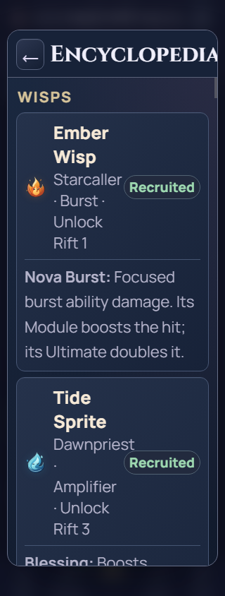
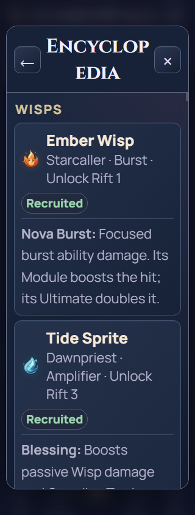

# Encyclopedia and How to Play verification

14 October 2026. Local implementation verified; combined/release acceptance OPEN.
Baseline `c834e16` on `local/full-debug`; product SHA-256:
`f3321623ea6189502d56f4030df18c350f89e021727fe94dd92fe3213d2c4b7a`.
Node24.19.0, Chrome151.0.7922.34; existing Node8.3.0/V8 6.0 for syntax checks.

## Corrected explanations

The Encyclopedia keeps all eight Wisps, eight Bonds and six currencies. Its core
mechanics grow from15 to29 entries; How to Play grows from3 to6 short pages.
Descriptions were compared with current code, not archived/proposed mechanics.

| Finding | Implemented explanation / authority |
| --- | --- |
| Motes said “only” Luminous kills; Prisms said “only” Ascend | Motes also come from Field Notes completions and Ascension Dust. Seventh login reward gives3 Prisms. `finishStudyRecord`, `treeAscendMotes`, `DAILY_LOGIN_REWARDS`. |
| Currency spending omitted Rarity/Modules or multiple Lab projects | Explain both Lumen/Shard prices, individual paid speed boosts and per-level speed reset. `rarityCost`, `moduleCost`, `commitStudyStart`, `applySpeedTier`. |
| Combat help omitted later Forge effects | Explain automatic charge, Arcane Calibration/Resource Conduction, reward Bonds, Dual Channel/Overflow, Guardian Cadence and owned Support/boss modifiers. Keep existing role/output distinctions. |
| Farm suggested preserving the exact enemy | Returning to Push keeps the progression Rift but spawns a fresh enemy. Auto-Ascend waits in Farm. `enterPushMode`, `autoAscendReady`. |
| Permanent systems and automation were underspecified | Describe five/six Formation slots, saved presets/recruit rebuild, immediate Forge versus completed Lab bonuses, separate Lab/speed spending permissions, manual Tree purchases, Auto-Tap/Auto-Empower Deeds and Auto-Ascend targets. |
| Resonate/Refresh description used dense implementation wording | Show current Sigil cost/run capacity, preserve Support recast timing, and show current Refresh price/access and retained daily progress. No purchase logic changes. |
| Earlier combined upgrade paths were missing | Explain preserved old bonuses, remaining paid work and current destinations for future purchases. `UPGRADE_FUSIONS`, `legacyUpgradeMarkup`. |
| Offline wording implied purchasing new Lab rate levels | Echoing Rest is the current rate path; old Rift Attunement bonuses remain. Rate never extends the12-hour cap. The earlier Fair Play card receives this clarification too. |
| Missing guidance for Comet commands, estimates and saves | Explain shared charges/manual commands, Collection/retained Journal items, overlapping contribution estimates, and backup/restore/reset. |

Six tutorial pages cover Fight/Recruit, Formation/Farm, persistent Wisp upgrades,
Forge/Lab and paid queues/speed, Ascend/automation, and offline/backup. They use
current UI names and explain the reset cost rather than promising endless progress.

## Checks and preservation

- [Copy/preservation audit](copy-audit.json): source outside four help arrays,
  two description helpers and six scoped help CSS rules is byte-identical to
  baseline. Combat, purchases, balances, save code, other UI and assets remain.
- [Browser inspection](checks.json):457 assertions across12 profiles PASS.
  Widths320/390/430px,100/200% root text, normal/reduced motion. All51 Encyclopedia
  cards wrap; all six tutorial pages advance/finish; Skip/Escape/Back and original
  focus return work. Reading/replaying preserves full game state and both exact
  persisted save slots. Owned Lab/Forge descriptions show15-Sigil Resonate/five
  uses,30%/55% Support, x2 Fractured ability/x3.5 Guardian taps and fit at large text.
- [Existing control/accessibility regression](controls.txt),
  [navigation](navigation.txt), and [save-backup12 profiles](save-backup.txt) PASS
  on the final staged source with unchanged assertions/deadlines. Uses the existing
  Windows CDP pipe transport, not a claim of standard dump-DOM acceptance.
- Source validation, actual task context/startup budget and whitespace PASS.
  [Both product scripts parse under existing V8 6.0](legacy-syntax.json).
- [Preview](preview.json): all15 root/staged/HTTP assets match at
  http://127.0.0.1:4174/index.html. App preview opening returned queued; a visibly
  loaded/reloaded user tab is not claimed. Reload to read the new help.

The unchanged baseline reproduced Encyclopedia Wisp name/meta clipping at
320px/200% text. Its heading also pushed Close outside the visible header. A
small CSS repair lets heading text wrap and moves status badges to the next line
when needed; names/metadata keep their available width. The same inspection then
passes. The initial copy-only and baseline failures remain in raw evidence;
the intermediate397-check run is superseded by the final457-check owned-upgrade
inspection. No assertion or deadline was relaxed to hide a failure.

Screenshots below and the normal390px Encyclopedia/tutorial screenshots were
visually reviewed. Before/after large-text images differ in owned upgrades in
the final fixture; the clipping comparison concerns the same names/header/metadata.

| Original320px/200% | Corrected320px/200% |
| --- | --- |
|  |  |

[Normal Encyclopedia](encyclopedia-390.png), [normal tutorial](tutorial-390.png),
[enlarged tutorial](tutorial-320-large.png).

Reproduce supplemental inspection with
`node docs/qa/help-copy-001/inspect.cjs validation-evidence/help-copy-001/new-inspection`.
It reuses the complete-product shared-layout driver and isolated browser profiles;
it does not alter existing CI tests, product hooks, purchase handlers or timers.
Only the original test prelude pauses ambient intervals, preserving native frames,
startup, fonts and actual touch/keyboard handlers. Raw receipts/screens/scripts
remain under `validation-evidence/help-copy-001/`.

Self-review only. Modern browser/root-font checks are not Android textZoom,
WebView60 or TalkBack/device acceptance. GitHub access, main integration, full
required combined CI and release acceptance remain pending in the existing debug/
release tasks. Whole-source offline oracle stamps need final combined-source
verification without changing historical gameplay values. No push/APK/signing/
release/archive; this chat stays open.
