# Rift hint inset — local verification

14 October 2026. Branch `local/full-debug`, parent `fd046ec`. Node24.19.0,
Chrome151.0.7922.34. Owner self-review; no independent review claim.

Baseline source: `ac190cdf4632c12e2c0fda23a406078f1a0ae6cec7b35bad88ab39d13d4a9188`.
Candidate source: `db843a8bb95244a00c81fd04ae2ef5991f99df7e5c9eb64990eead5688ae747e`.

The original strip touched both viewport edges. The candidate insets each edge
10px, aligns it with the enemy panel, and paints a noninteractive gradient from
the HUD background into the arena gap behind it. A subtle shadow softens the
edge. The slot remains46px tall; its controls remain44px tall. Fonts, solid hint
background, ink, borders, full scrollable hint content and handlers are unchanged.
No product JavaScript, markup, save, price, balance or asset changes.

## Checks and reproduction

Use the installed browser below as CHROME (an absolute executable path):

```text
C:/Users/xarib/Documents/Codex/2026-10-13/https-github-com-karahanx-lumenfall-https/work/browsers/chromium-1234/chrome-win64/chrome.exe
```

From the repository root, stage current index.html/fonts/branding in mobile/www.
The baseline was staged from the parent before editing. Commands:

```text
node tests/behavioral/rift-guidance.cjs CHROME mobile/www docs/qa/rift-hint-layout-001/before --layout-before
node tests/behavioral/rift-guidance.cjs CHROME mobile/www docs/qa/rift-hint-layout-001/after --layout-probe --layout-reference=docs/qa/rift-hint-layout-001/before/results.json
node tests/behavioral/rift-guidance.cjs CHROME mobile/www docs/qa/rift-hint-layout-001/guidance
node tests/behavioral/rift-guidance.cjs CHROME mobile/www docs/qa/rift-hint-layout-001/contracts --existing-contract
node scripts/codex/check_context.cjs --task docs/tasks/RIFT_HINT_LAYOUT_001.md
node scripts/ci/validate_source.cjs
git diff --check
```

- Before and after: each16 profiles/32 fresh and boss samples PASS, at320/360/
  390/430px,100/200% root text and both motion modes. Actual baseline comparison
  retains every measured currency/combat box, slot y and height. Native Space
  hide/touch show preserve state/storage/geometry. Inset fits, keyboard outline
  remains visible, decorative layer cannot receive input and disappears with
  the strip outside Rift. Removing inset or fade in isolated DOMs is rejected
  by its corresponding assertion; restoration passes (after/results.json).
- Existing full Guidance:16 profiles/160 samples PASS (guidance/results.json).
  Ordinary/long hints, leading-word readability, enlarged text, scroll via native
  keyboard/touch, Tab order, accessible names/hidden AX tree, title/detail/toggle
  contrast, fixed combat geometry, settings, reload preference, actual hint
  navigation, six themes, Comet cosmetics/Trial and Ascend-ready coverage retained.
  Existing collapsed-reservation and old-width readability controls reject as
  expected. All browser processes exit cleanly; runtime errors are empty.
- Existing Rift contract1738 and Workshop/navigation contract415 assertions PASS
  (contracts/results.json). Source validation:2 scripts,16 required unique IDs and
  lifecycle guards PASS. Task context and whitespace checks PASS.
- All15 current source/fonts/branding files equal mobile/www and the HTTP-served
  bytes ([manifest](preview-assets.json)). Preview:
  [play locally](http://127.0.0.1:4174/index.html).

The sandbox browser exited before readiness; the same driver passed using
approved outside-sandbox execution. A sandboxed preview server was inaccessible
over host loopback; it was stopped and replaced by an outside-sandbox server,
after which all15 HTTP checks passed. App preview opening returned `queued`.
The browser UI inspector rejected the local URL under its URL policy; no
workaround was attempted and no actual visible-tab/script inspection is claimed.
Test screenshots below were captured by the already-running regression driver.
Its isolated fixtures dismiss only the transient welcome toast for comparison.

## Before / after screens

Fresh Rift, identical profiles. Each pair has normal and200% text evidence;
boss and hidden-strip screenshots are also saved in before/ and after/.
The images were visually reviewed at narrow/large-text and boss profiles.

| Mobile profile | Before | After |
| --- | --- | --- |
|320px,100%|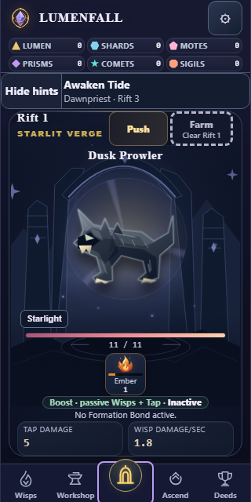|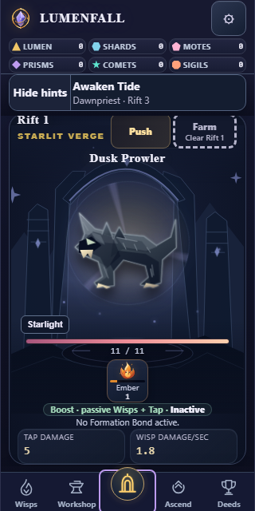|
|320px,200%|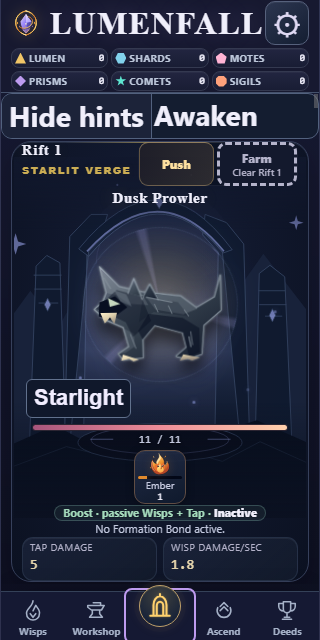|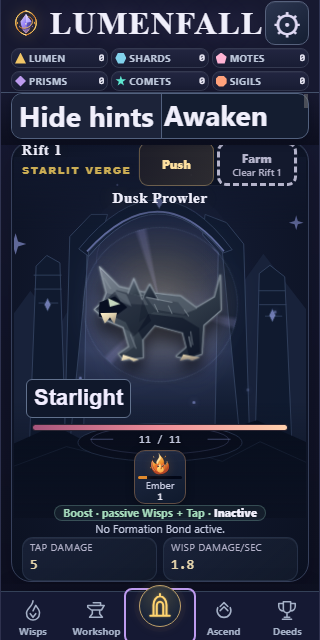|
|360px,100%|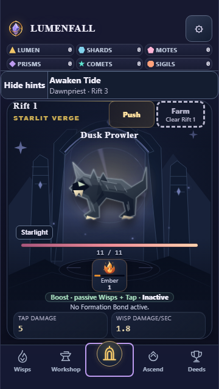|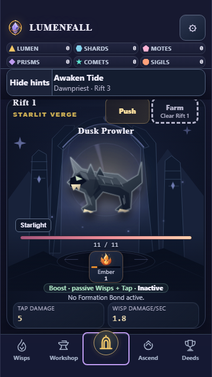|
|360px,200%|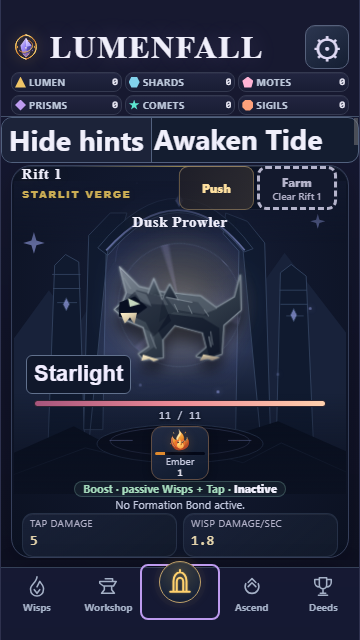|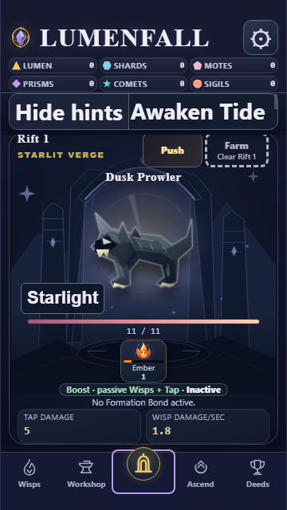|
|390px,100%|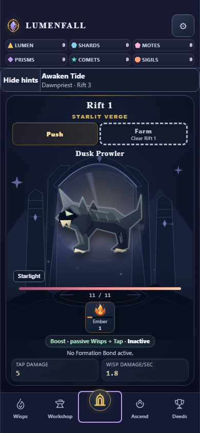|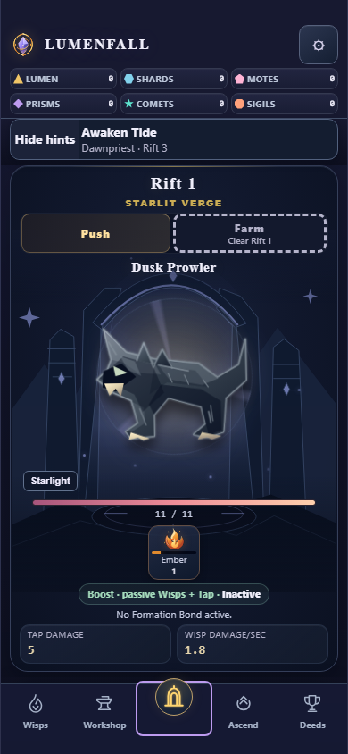|
|390px,200%|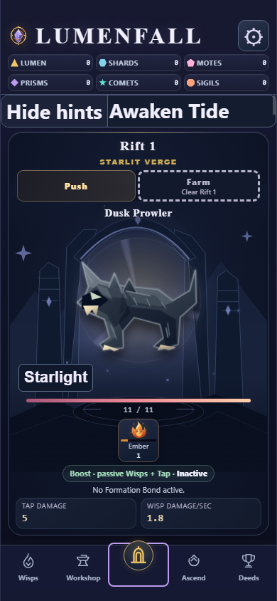|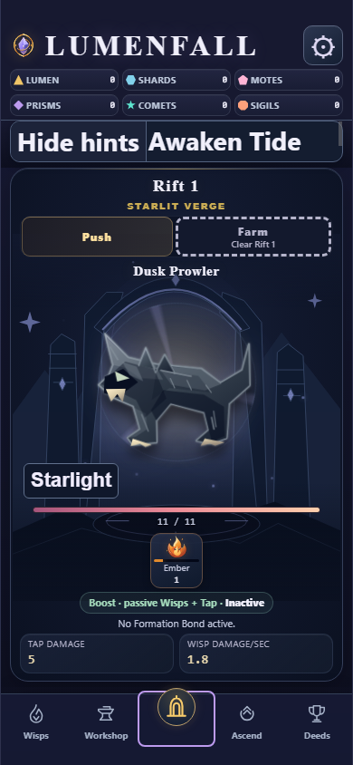|
|430px,100%|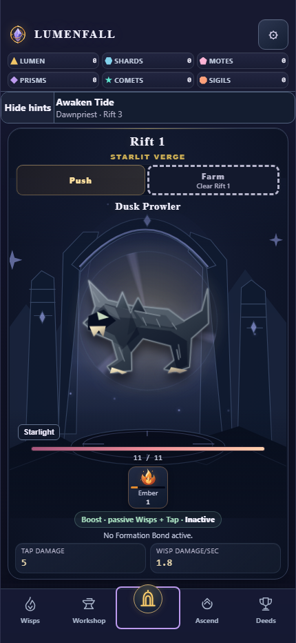|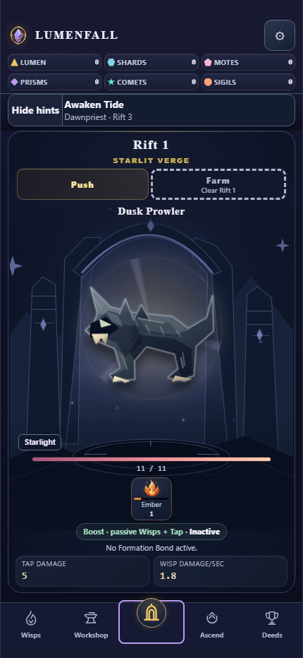|
|430px,200%|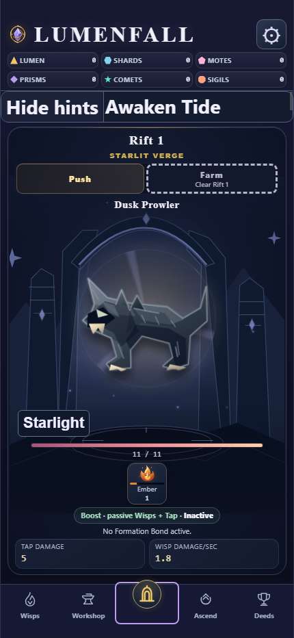|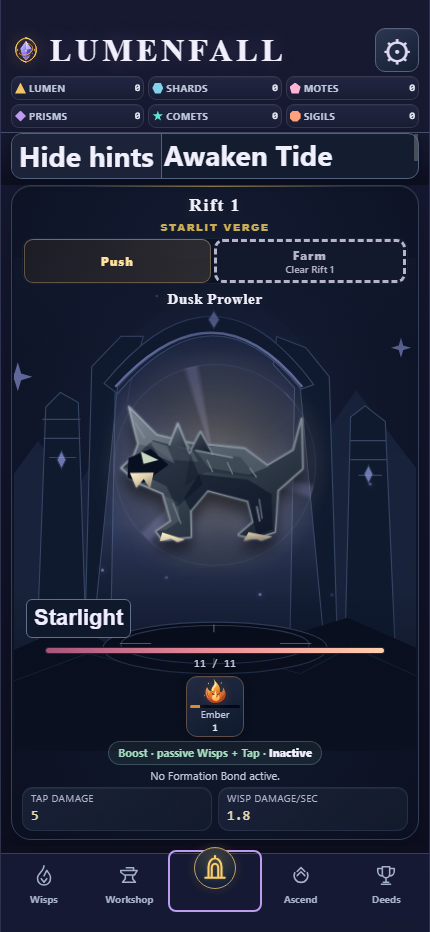|

## Deferred acceptance

Local implementation milestone only; user preview acceptance, final combined
behavioral/required CI gates and Android/device/WebView60/textZoom/TalkBack remain
pending. This CSS uses standard positioning, gradients, shadow and pointer-events,
without adding a modern selector/runtime dependency; that is not native proof.
Inherited Prism-contract deadline, standard Windows dump-DOM/POSIX tooling and
release/integration limitations remain open. No remote, APK, signing or archive
action. Next: review the preview, then the separately assigned RIFT_THEME_LABEL_001.
