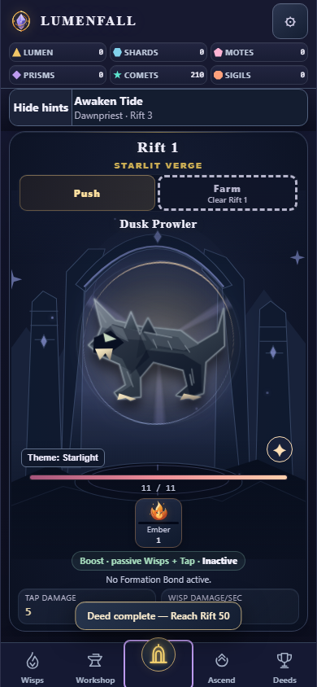
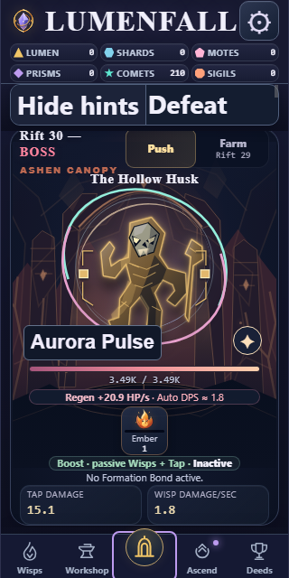
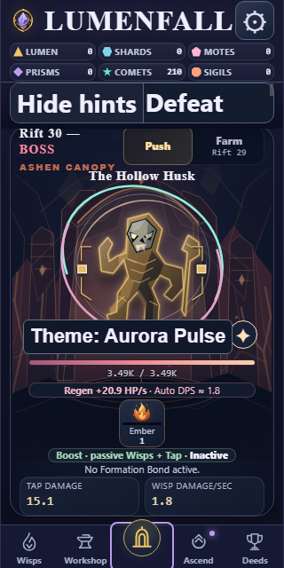

# Rift theme label — local evidence

14 October 2026. Branch `local/full-debug`, parent `23074a9`. Owner self-review.
Node24.19.0 / Chrome151.0.7922.34. No independent review or Android acceptance.

Baseline source: `db843a8bb95244a00c81fd04ae2ef5991f99df7e5c9eb64990eead5688ae747e`.
Candidate source: `f8f787fd4a520ec277b350f40c6caeefa519c48cb55ddeb9bbe486e4cd0200b6`.

The enemy caption originally showed only the selected name. It now reads
Theme: Starlight, Theme: Ember Veil, Theme: Void Bloom, Theme: Aurora Pulse,
Theme: Solar Crown or Theme: Radiant. Markup and runtime rendering are the only
two product line changes. No CSS, assets, unlock, effect, selection, combat,
price, progression, balance or save/schema change.

## Reproduction and commands

CHROME below is the installed absolute executable:

```text
C:/Users/xarib/Documents/Codex/2026-10-13/https-github-com-karahanx-lumenfall-https/work/browsers/chromium-1234/chrome-win64/chrome.exe
```

Commands from repository root; the baseline ran against the parent before editing
product. Refresh mobile/www from current index.html/fonts/branding first.

```text
node tests/behavioral/rift-cosmetics.cjs --chrome CHROME --label-before --out docs/qa/rift-theme-label-001/before
node tests/behavioral/rift-cosmetics.cjs --chrome CHROME --source mobile/www/index.html --negative --label-reference docs/qa/rift-theme-label-001/before/results.json --out docs/qa/rift-theme-label-001/after
node tests/behavioral/rift-guidance.cjs CHROME mobile/www docs/qa/rift-theme-label-001/guidance
node tests/behavioral/rift-guidance.cjs CHROME mobile/www docs/qa/rift-theme-label-001/contracts --existing-contract
node scripts/codex/check_context.cjs --task docs/tasks/RIFT_THEME_LABEL_001.md
node scripts/ci/validate_source.cjs
node docs/qa/rift-theme-label-001/verify-preview.cjs
git diff --check
```

- [Baseline](before/results.json):167 samples PASS; bare captions reproduced.
- [Candidate](after/results.json):170 samples PASS. Six themes x normal/boss/
  Luminous x nine profiles =162 measured theme cases. Profiles cover320/390/430px,
  100/130/200% root text and normal/reduced motion. Full text and line rectangles
  fit; no HP overlap; HP/name/tap geometry exactly matches captured baseline.
  Static markup and effective default caption for stale locked preference pass.
  Unlocks, region palettes, independent Comet layers, keyboard selection/focus,
  native browser touch damage, primary/recovery persistence, backup serialization,
  real reload/corrupt-primary recovery/backup restore are preserved. No runtime
  errors; browser exits with code0. Existing hidden-aura control plus unclear-label
  and clipped-label controls reject their intended defects; restored labels pass.
- [Rift/navigation](contracts/results.json):1738 Rift and415 Workshop/navigation
  assertions PASS with clean teardown and no runtime exceptions.
- [Existing full Guidance](guidance/results.json):16 profiles/160 samples PASS.
  Hint readability/contrast, native keyboard/touch, scrolling, hidden accessibility,
  settings/reload/navigation, all six themes and independent Comet layers retain
  their contract. Existing readability and reserved-space controls reject as
  expected. Clean browser teardown and no runtime exceptions.
- Source validation:2 scripts,16 unique required IDs and lifecycle guards PASS.
  Actual task context/startup budget and whitespace PASS.
- [Preview manifest](preview-assets.json): all15 current source/fonts/branding
  files equal mobile/www and HTTP-served bytes. Playable
  [local preview](http://127.0.0.1:4174/index.html); app opening returned queued.

Initial sandbox Chrome exited before startup (3221225506); outside-sandbox local
execution passes. The driver needed the existing cross-platform browser resolver
instead of Unix which. A Windows chrome --version subprocess stalled its final
report and was interrupted; browser protocol version now reports without a CLI
subprocess. Original tests/assertions remain, with the caption expectation updated
for the requested wording and additional fit/fallback/causal coverage.
Sandbox loopback fetch cannot reach the host server; outside-sandbox asset
verification passes. These are environment/test-driver issues, not product failures.

## Visually reviewed before / after

Normal390px and narrow320px/200% longest-name screenshots were visually reviewed.
All six narrow/large-text theme screenshots are saved beside the result receipts.

| Profile | Before | After |
| --- | --- | --- |
|390px,100%,Starlight|||
|320px,200%,Aurora Pulse|||

## Pending acceptance

Local implementation milestone only. User preview acceptance, final combined
behavioral/required CI and installed Android/device/WebView60/native textZoom/
TalkBack acceptance remain pending. Modern browser checks do not prove Android.
Inherited Prism contract deadline and Windows standard dump-DOM/POSIX tooling
limitations remain open in the debugging task. No remote/push/APK/signing/archive.
Next: user reviews the preview; task7 FORGE_LAB_CAPS_001 needs named numeric cap
decisions before changing balance. Final combined acceptance stays separate.
