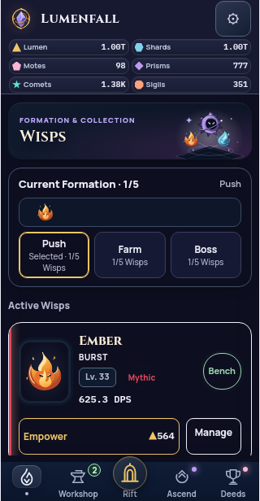
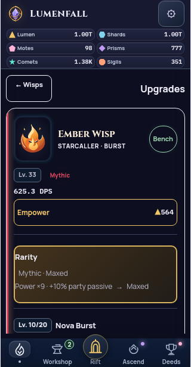

# Wisp cards — Android0.2.150 evidence

[PR65](https://github.com/xariib/Lumenfall/pull/65) replaces dense expanding
Wisp cards with a compact portrait roster and one flat management screen.
Original artwork, gameplay, prices, requirements and saves remain.

Integrated source `c455dbf3d4ad03942fb5c593562e561ecb80387b`, product SHA256
`b24494d6f4a4833c83922467e141454174efb9cbe4866e8d9e5ef7ebc45c805e`.
[Task and original Dribbble references](../../tasks/WISP_CARD_REDESIGN_001.md).

## Verified delivery

- [Public Android0.2.150](https://github.com/xariib/Lumenfall/releases/tag/android-1000150),
  signed build44755733048, versionCode1000150. Stable package/certificate.
- [Anonymous public verification](android-release/public-verification.json):
  latest/tag downloads, update feed, metadata and all14 packaged assets match
  the tested APK. APK SHA256
  `bc18ef4bcc3e640818412ac1a69a24ec53fccfa507c02727573231e6b35123b0`.
- [Nine exact integrated workflows](integrated-validation.json),
  [190 main cases/220 profile executions](local/integrated-main-coverage.json)
  and one isolated offline case PASS. Raw job logs/receipts are in `remote/`.
- [Android upgrade](android-release/emulator-upgrade.json),
  [trusted all8 Manage/Back visits](android-release/installed-wisp-disclosure-input.json),
  actual Ability purchase, UID/both slots/paid progress/cold restart and
  [five-Wisp migration](android-release/installed-five-wisp-migration.json) PASS.
- [Actual updater](android-release/in-app-updater.json) and
  [normal retail launch](android-release/production-runtime.json) PASS.
  Android12/WebView91; no debugger/instrumentation in the final retail APK.
- [Preservation](local/preservation.json):636 protected functions and catalogs
  match148. [Independent offline reference](local/offline-reference.json)
  retains four historical and four current8h windows.
- [Compact parent](local/compact.json):42570checks/18profiles, plus
  [focused redesign](local/matrix.json):1182checks/12profiles and real native
  input/touch-buffer causal controls PASS. All original purchase and save
  assertions remain; no workflow definition/shared fixture changed.

## Visual evidence

Final Android roster cards measure176px each at320px, versus288–292px released
before the redesign. Original portraits lead the short identity and controls.
All upgrade and ability detail is reached through Manage without accordions.

| Final installed roster | Final installed management |
| --- | --- |
|  |  |

Browser captures: [320px roster](local/roster-320-100.png),
[200% roster](local/roster-320-200.png),
[management](local/manage-320-100.png),
[200% management](local/manage-320-200.png).
Screenshots and the actual Dribbble references were visually self-reviewed;
no third-party artwork copied. [Self-review](SELF_REVIEW.md).

## Limits and continuation

[Development history](DEVELOPMENT_HISTORY.md) retains failed candidates,
observed regressions, fixes and browser startup timeouts with unchanged reruns.
Private149 is an older candidate, superseded by public150.

Physical phone installation/update, Google Play Protect verdict, exact WebView60
DOM, TalkBack and human design/long-term pacing acceptance remain unobserved.
[Static security](android-release/security.json) records Google classification
as `NOT_TESTED`; it does not establish that the reported warning has cleared.
No independent human review, store/account action, new binding rule or archive.
Task/chat remains open for this external acceptance. [Delivery index](delivery.json).

The final documentation sweep checked143 task files:136 pass, seven old
history/proposal/Deeds/Comet files retain their baseline link or size failures.
All38 workflow-referenced task contexts plus this feature pass. The shared
status shrank56bytes; no new context failure was introduced. Baseline/current
receipts and exact errors: [comparison](context-comparison.json). Unrelated
historical documentation repair remains a separate task.
