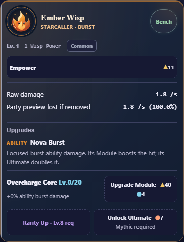

# Simpler Wisp cards

Latest follow-up: [separate Rarity/Ability, clear levels and Current/Next](split-progression/README.md).

Latest follow-up: [boxed Ability badge and exact currency upgrade names](ability-badge/README.md).

Latest follow-up: [one ability identity, no secondary upgrade name](one-name/README.md).

Latest follow-up: [clear Upgrade Ability / Upgrade Rewards labels](labels/README.md).

Latest user revision: [remove previews, boxed levels, simpler headings](revision/README.md).
That revision supersedes this first layout milestone; the receipts below remain
historical evidence for the initial request.

14 October 2026. LOCAL IMPLEMENTATION VERIFIED, combined with Formation follow-up
`c16fc35`. Self-review and automated checks only; release acceptance remains OPEN.
Final source: `3ebf0632351e1d554d7bc9f5d8be8c5c3d7776b96a9877b3cdc08e44173a2cb3`.
Integrated locally at `57b99ce` on `local/full-debug`. [Current preview receipt](final-preview.json)
verifies all15 source/staged/HTTP assets at http://127.0.0.1:4174/index.html.
App opening returned queued; reload the preview to review the new cards.

Final [registered layout](final-layout.txt):17,592 checks/12 profiles PASS,
including Wisp-specific accessible names on the shorter headings/disclosures.
[Combined receipts](combined/) preserve Formation541/12, Wisp upgrades12,912/12,
scroll/purchases3,229, contribution core8,099/mobile151/12, hierarchy/navigation/
controls PASS. Those regressions use source `51f9a986`; the only later product
change adds two aria-label attributes. [Exact preservation](final-preservation.json)
proves no visible text, geometry, actions or calculations changed afterward;
final layout/accessibility was rerun on final bytes. [Source](final-source.txt)
and [actual V8 6.0 parsing](final-legacy-syntax.json) PASS. Both complete product
scripts parse. No claim of native Android accessibility follows from DOM checks.

The Wisp card uses one surface instead of nested ability/Module panels. Level
and power use plain text; rarity keeps its badge. The heading is “Upgrades”.
Module purchases show inline prices beside the effect where space permits.
Rarity/Ultimate actions share a row and wrap on narrow screens. Locked Rarity
now identifies the action as well as its level requirement. Unfinished upgrades
stay visible; completed cards retain native folding. All readouts/effects remain.

Baseline Ember height:676.84px at320px,635.34px at390/430px. Candidate:587.84px
at320px,480.03px at390/430px (24.4% shorter at390px). Same starting fixture.

- [Baseline upgrades](baseline/wisp-upgrades-result.json):12 profiles/12,912 PASS.
- [Before layout](layout-before/wisp-upgrades-result.json):12 profiles/15,960 PASS.
- [Registered layout](registered.txt):12 profiles/17,304 checks PASS. Eight Wisps,
  starting/funded/completed stages,320/390/430px,100/200% text, normal/reduced
  motion. Full state/both save slots retained;44px controls and no clipped text.
- [Upgrade regression](upgrades/wisp-upgrades-result.json):12/12,912 PASS.
- [Scroll/purchases](scroll.json):3,229 PASS, including native touch/keyboard,
  exact spending/rewards/save state, final purchases, focus and repeated input.
- [Contribution core](contribution-core.json):8,099/56 teams PASS;
  [mobile](contribution-mobile/results.json):151/12 profiles PASS.
- [Existing hierarchy/roles](existing/wisp-upgrades-result.json):four scenarios
  PASS. Its initial invocation then stopped on an incorrect navigation scenario
  name; [correct navigation/control checks](navigation/wisp-upgrades-result.json)
  pass with unchanged assertions. This was a command selection error.
- [Original-design negative](negative-original-layout/wisp-upgrades-result.json)
  rejects the crowded original design at the plain ability-surface assertion.
- [Byte preservation](preservation.json): all product bytes outside scoped Wisp
  CSS, heading/rarity text and the action wrapper match baseline. No gameplay,
  payments, scheduler, saves or unlock changes. Source/context/whitespace PASS.
- [Initial preview](preview.json):15 source/staged/HTTP assets matched on isolated4175.
  App opening returned queued; actual user-tab loading is not claimed.

Normal screenshots and320px/200% text/actions screenshots were visually reviewed.
The runner pauses intervals only in throwaway layout/F04 profiles; the playable
preview retains normal game execution. Existing scroll/input coverage retains
its production lifecycle instrumentation.

Node24.19.0, Chromium151.0.7922.34. Windows sandbox prevented initial browser
launches; successful checks used the existing executable outside the sandbox.
No assertion/deadline was weakened. Combined final checks, GitHub/main/required
CI and Android/WebView60/native textZoom/TalkBack/device acceptance are pending.
No APK, remote publication or archive. Chat stays OPEN.

