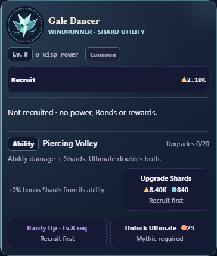

# Ability badge and specific currency upgrades

14 October 2026. User requests a little box like the level box left of the
ability name, and asks what Gale Dancer’s Upgrade Rewards means. Gale screenshot
shows an unrecruited Wisp, upgrades0/20 and Recruit first.

Added an Ability badge with the level box’s border/background beside each ability
name. Replaced generic Upgrade Rewards with Upgrade Shards for Gale, Upgrade
Lumen for Thorn and Upgrade Motes for Tide/Aurora. Damage upgrades remain Upgrade
Ability. Tutorial/Encyclopedia now name those currency actions explicitly.

Verified semantics: moduleMult=1+level*0.05; abilityRewardRaw applies it to Gale’s
Shard ability reward. Each level adds5 percentage points to that bonus. The base
ability gives Shards once recruited;0% means no purchased bonus. Recruitment and
all existing prices/eligibility remain unchanged.

Baselinee9db86e/source43e158bb. Final source SHA256:
`dfa264535cca75913cc04b3d93fa231be0149246d52429ab1a52ac167b74ca54`.
Integrateda39a5a1 on local/full-debug. [Preview receipt](preview.json) verifies
all15 source/staged/HTTP assets at4174. Existing tab retained; reload unclaimed.
[Byte preservation](preservation.json) proves only two CSS rules, three label
strings, two help entries and one rendered header changed. Effects, formulas,
rounding, prices, save/purchase/focus and latest Formation code are identical.

- [Layout](layout.txt):18,072 checks/12 profiles PASS. All8 Wisps at starting/
  funded/completed stages,320/390/430px,100/200% text, normal/reduced motion.
  Badge matches level box and stays left of the name; exact currency labels/
  accessible names, effects/both prices,44px controls/no clipping, full state and
  both persisted save slots retained. Gale normal/200% screenshots reviewed.
- [Existing upgrades](upgrades/wisp-upgrades-result.json):12,912/12 PASS;
  eligibility/prerequisites, final purchases, folding/visibility, focus and saves.
- [Scroll/purchases](scroll.json):3,229 PASS, native touch/keyboard/mouse, exact
  spending/rewards/save fields and repeated/periodic focus/viewport behavior.
- [Source](source.txt), context/whitespace and [V8 6.0 parsing](legacy-syntax.json)
  PASS. Node24.19.0/Chromium151.0.7922.34. Self-review and automated checks only.

Test-only screenshot selection now accepts --present-wisp gale; default Ember and
all existing fixtures/assertions are retained. No production test hooks shipped.
The staged source is exact. Full combined CI/GitHub/main and Android/WebView60/
native textZoom/TalkBack/device acceptance remain OPEN. No APK/remote/archive.

