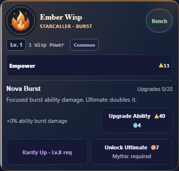

# One ability name per card

14 October 2026. User finds Nova Burst + Overcharge Core + Upgrade Ability
cluttered. Secondary Core/Lens/Catalyst/Focus names are removed from all cards.
The ability title now includes its permanent upgrade count, with the bonus and
existing purchase button immediately below. Descriptions omit repeated upgrade
sentences. Upgrade count0/20 preserves the already-usable base ability.

Baseline45fb848/source9f382d3f. Final source SHA256:
`43e158bb2395fdb78affd8541e3fc78f5c3d86b4125740cf410d58be4589fbc9`.
[Preservation](preservation.json): CSS, four descriptions and two rendering
fragments only. Catalog/save identities, effects, caps, all prices, formulas,
purchase/focus handlers and the latest Formation behavior are byte-identical.
No migration or gameplay change. Full diff and normal/200% screens reviewed.

- [Registered layout](layout.txt):16,920 checks/12 profiles PASS. All8 Wisps,
  correct starting/maxed count, one ability identity, retained effects/prices,
  accessible labels,320/390/430px,100/200% text and normal/reduced motion;
  all controls44px, no clipping and full state/both-save-slot preservation.
- [Existing upgrades](upgrades/wisp-upgrades-result.json):12,912/12 PASS.
  Unfinished visibility/completed folding, eligibility, final purchases, native
  keyboard/focus, saves/recovery/backup retained.
- [Scroll/purchases](scroll.json):3,229 PASS, touch/keyboard/mouse, exact paid
  changes and repeated/periodic focus/viewport behavior.
- [Existing hierarchy/roles/text](existing-final/wisp-upgrades-result.json):three
  PASS; Bond text253 checks. The initial text check still demanded the removed
  repeated Module phrase. It now verifies the actual unchanged20-level effect
  beside each of all8 abilities, with existing role/Ultimate/partnership checks.
  Initial failing receipt remains in existing/. No acceptance requirement lost.
- [Negative control](negative-result.json): expected exit1 at unchanged “stone
  ability does not repeat Bond partnerships” assertion, no runtime errors.
  Mutation anchor follows shortened source text. Raw final pipe-transport output
  is negative-final.txt; initial default-transport output is negative.txt.
- [Source](source.txt), context/whitespace and [V8 6.0 parsing](legacy-syntax.json)
  PASS. Node24.19.0/Chromium151.0.7922.34. Self-review and automation only.

Local milestone. Final combined CI/GitHub/main and Android/WebView60/native
textZoom/TalkBack/device acceptance remain OPEN; no APK/remote/release/archive.

