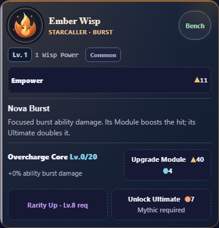

# Wisp card revision

14 October 2026. User requests removal of Raw damage and Party preview, further
simplification and a small box around each Wisp level. This supersedes the earlier
display-preservation requirement for those two rows.

Baseline49403e2/source3ebf0632. Candidate source SHA256:
`35846c8f2a1bdb4d8ea2a50ffa1cad83303b18f2d8ba21a087e5d737e08e8580`.
Integrated locally9da5370 on local/full-debug. [Preview receipt](preview.json)
verifies all15 source/staged/HTTP assets at http://127.0.0.1:4174/index.html.
App opening queued; actual visible-tab reload is not claimed.

Removed both rows from every card; empty readouts take no space. Support/resource
effects and enabled Bonds remain. Levels have a bordered badge. The ability name
replaces the unfinished Upgrades heading and Ability label, retaining the same
focus target and accessible Wisp context. Completed folding remains. Encyclopedia
now describes Wisp Power and role effects accurately.

Wisp Power is level/rarity power. Raw damage also included global passive bonuses,
averaged abilities and attributable Auto-Tap; they are related, not identical.
All calculations remain byte-identical. [Preservation](preservation.json) and
complete diff review confirm presentation/help changes only; purchase handlers,
prices, saves/progression and game rules are unchanged. No migration needed.

- [Registered layout](layout.txt):15,960 checks/12 profiles PASS. All8 Wisps at
  initial/funded/completed stages;320/390/430px,100/200% text and normal/reduced
  motion. Removed-row absence, boxed accurate levels, no empty spacing/clipping,
  accessible headings,44px controls and full state/both-save-slot purity.
- [Upgrades](upgrades/wisp-upgrades-result.json):12,912/12 PASS. Unfinished tracks
  remain open and visible; completed folding, affordability, final purchases,
  native keyboard/focus and save/recovery/backup checks retained.
- [Scroll/purchases](scroll.json):3,229 PASS, native touch/keyboard/mouse,
  exact spending/rewards/save fields, repeated input and periodic focus/scroll.
- [Core](core.json):8,099 PASS; [role UI](roles/results.json):163/12 PASS, including
  remaining Support/Mote/resource/Bond readouts, no removed rows, touch/keyboard.
- [Formation](formation/results.json):541/12 PASS. Prior Formation revision kept.
- [Existing assertions](existing/wisp-upgrades-result.json):hierarchy, role,
  navigation and control scenarios PASS, unchanged assertions/deadlines.
- [Source](source.txt), context/whitespace and [actual V8 6.0 parsing](legacy-syntax.json)
  PASS. Two complete product scripts parse. Node24.19.0/Chromium151.0.7922.34.

Normal and320px/200% screenshots visually reviewed. Same starting Ember card:
390/430px480.03→379.03px;320px587.84→463.34px. Test intervals pause only in
throwaway layout/F04 fixtures; playable game timing is unchanged. Self-review.
The focused tests replace the superseded row-presence expectation with requested
absence/level-box checks and retain other coverage. No gates were removed.

Local milestone only. Full combined CI/GitHub/main and Android/WebView60/native
textZoom/TalkBack/device acceptance remain OPEN. No APK/remote/release/archive.

