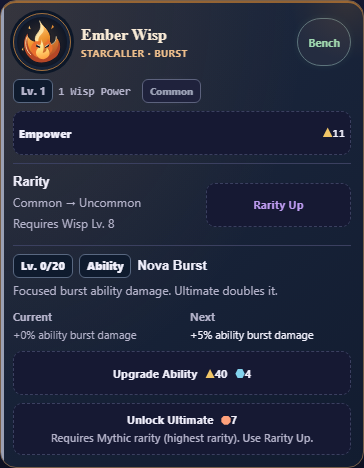

# Separate rarity and ability progression

14 October 2026. User asks for an understandable Ultimate rarity requirement,
Rarity Up separated from ability upgrades because it uses Wisp level, a clearer
ability-level badge left of Ability, and Current/Next effects.

Rarity now has its own section: current→next tier, explicit Requires Wisp Lv.N
and an associated Rarity Up button. Ability has a separate section with Lv.0/20
before the Ability badge/name, Current/Next upgrade bonuses and its purchase/
Ultimate. Ultimate explains “Requires Mythic rarity (highest rarity). Use Rarity
Up.” Maxed ability shows Next: Maxed. Level0 remains the existing base ability.

Baseline5ef250a/sourcedfa26453. Candidate source SHA256:
`e110f182e500eed4bbb0382d182471c93110da28fda97fff4856b5931791a9ac`.
Integrated49f0919 on local/full-debug. [Preview receipt](preview.json) verifies
all15 source/staged/HTTP assets at4174. Existing tab retained; reload unclaimed.
[Byte preservation](preservation.json) proves CSS/UI markup and prerequisite text
only; all actual gates, effect functions, prices, purchases, progression, saves,
focus handlers and latest Formation code remain unchanged. No migration/reset.
Both sections stay inside existing progression: unfinished tracks always visible,
folding available only when all existing completion conditions hold.

- [Layout](layout.txt):21,528 checks/12 profiles PASS. All8 Wisps at0,19 and20
  ability upgrades,320/390/430px,100/200% text, normal/reduced motion. Separate
  sections, explicit associated Wisp-level requirement, correct Current/Next at
  19→20 and cap, clear Ultimate route, badge order, prices/effects/accessibility,
  44px controls/no clipping and full state/both-save-slot render purity.
  High ability level cannot bypass low Wisp level; funded rarity can be bought
  with zero ability upgrades when Wisp level qualifies.
- [Existing upgrade coverage](upgrades/wisp-upgrades-result.json):12,912/12 PASS,
  all completion combinations, eligibility/prerequisites, final purchases,
  folding/focus, save/recovery/backup and configurable authoritative Module cap.
  Its restore-focus check now targets data-wisp-details instead of the first h3,
  since Rarity has its own heading. Same required focus target; no gate removed.
- [Scroll/purchases](scroll.json):3,229 PASS, native touch/keyboard/mouse, exact
  spending/rewards/save fields and repeated/periodic focus/viewport preservation.
- [Existing assertions](existing/wisp-upgrades-result.json):hierarchy, role,
  Bond text, accessibility/control and navigation scenarios PASS, unchanged.
- [Source](source.txt), context/whitespace and [actual V8 6.0 parsing](legacy-syntax.json)
  PASS. Node24.19.0, Chromium151.0.7922.34. Normal and320px/200% screens reviewed.

Self-review/automated checks only. Modern desktop checks do not establish native
Android/WebView60/textZoom/TalkBack/device acceptance. Local milestone; user/final
combined CI/GitHub/main/native acceptance remains OPEN. No remote/APK/archive.

